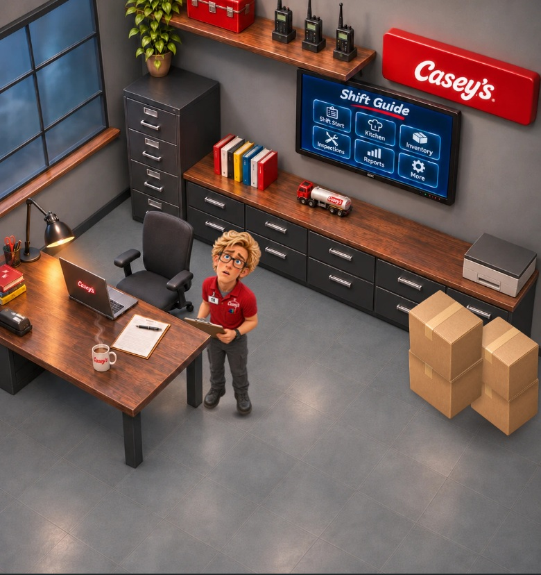

# Till at the desk

These stills come from the offline opening at a 390×844 phone viewport with reduced motion enabled.

| Opening | Discovery |
| --- | --- |
|  |  |

The opening uses a replacement standing-at-desk drawing with the clipboard on the same plane as the worktop. Discovery uses a matching drawing with the body turned toward the desk and the chin and eyes lifted toward the viewer. Both drawings keep Till at the previous projected height with one common floor anchor. Separate layers keep his hands above the tabletop and his boot shadows on the tiles.

The [post-reply still](03-after-reply.jpg) shows the dropped clipboard, slipped glasses, dusty red polo, and black pen in Till’s hair. The original pocket pens are still visible. Both reaction poses, the introduction, explanation, anticipation, dodge, recovery, and farewell carry that costume state. Skipping before either reply lands on the clean version of Till.

The room plate and carton layout are the same as the overhead preview. This pass covers framing and costume continuity at the existing cue points. The player and story timing come from the previous version.
