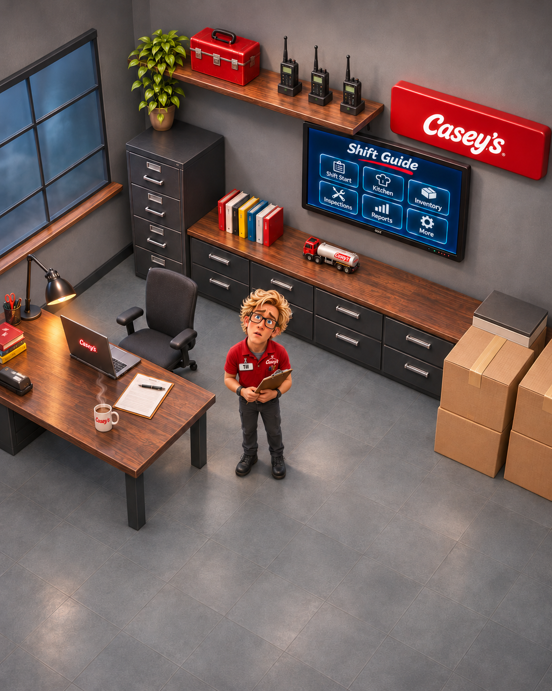

# Till’s office perspective proof

The discovery frame is a concept paintover of the 3D blockout. It uses the approved Till portrait and office artwork as design references. Till occupies about 27% of the frame height. His feet stay visible, and his chin and pupils point toward the viewer. The lower-left desk partly hides the chair base, while the filing cabinet, rear worktop, and sealed cartons read at different depths.

The [three-second camera test](camera-test.mp4) uses a perspective camera pitched 40° down from horizontal. It travels from 32° to 38° off the front axis. Watch the near desk edge move against the chair, then compare that movement with the rear cabinets. The test uses a simplified Till stand-in and shows the spatial blocking independently of the finished look in the still.

The existing office image is too frontal to supply the floor, furniture tops, or depth needed for this shot. The current discovery cutout supplies a useful reference for Till’s look and gaze. The five animated scenes would need an empty elevated office plate with a separate desk foreground, matched full-body Till poses, and separate cartons and packing peanuts with shadows and floor contact sized to this room. The proof is for reviewing that direction before changing the animation or the interactive intro.
